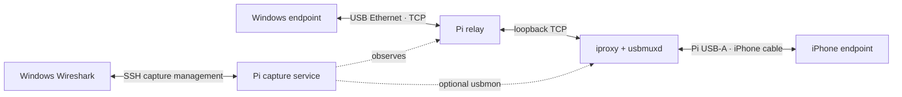

# USBLinkLab

USBLinkLab sends text, PNGs and binary files between a Windows app and an iPhone app. In the Raspberry Pi experiment, Windows uses a USB Ethernet gadget and the Pi forwards the application stream to the cabled iPhone. Wireshark can observe the stream on both sides of the relay. Each sender chooses Plaintext, AES-256-GCM, ChaCha20-Poly1305 or HMAC-SHA256 for each item.

**실험을 시작하려면 [한국어 설치·터치 시연 안내](docs/ko-touch-lab.md)를 여세요.** Windows의 연결 설정, iPhone에서 신뢰를 승인하는 순서, Pi의 캡처 버튼과 실제 Wireshark 화면을 설명합니다.

The Windows app also supports its original direct USB path through Apple Mobile Device Service. The Pi path uses the same ULAB v1 handshake, encryption and acknowledgments. The Pi has no role in application enrollment or key derivation. ULAB is an educational protocol without forward secrecy.

## Current hardware evidence

On 25 November 2026, Windows and a signed iPhone app exchanged text and images in both directions through the physical Pi. The iPhone acknowledged all 12 Windows-originated combinations of four modes and three payload types. Windows decrypted and saved two iPhone-originated AES-256-GCM transfers, a text and an image. That covers 14 of 24 planned combinations. Native Windows Wireshark displayed a live Pi gadget capture and reopened the saved PCAPNG. Independent hashes of the same image at both endpoints, the remaining return combinations and full cable/reboot recovery are still open. [Measurements and capture hashes](evidence/hardware/observations.md) · [Acceptance matrix](docs/acceptance.md)

## Run the lab

| Task | Where to start |
| --- | --- |
| Wire the Pi, set up the display, and run a Korean demo | [한국어 시연 안내](docs/ko-touch-lab.md) |
| Install and operate the Windows endpoint | [Windows app](apps/windows/README.md) |
| Install or sign the iPhone endpoint and enroll it | [iPhone handoff](docs/ios-handoff.md) · [QR and six-digit pairing](docs/ios-pairing.md) |
| Review the deployment, routes and trust boundaries | [Transport architecture](docs/relay-transport.md) |
| Install the Pi data services and inspect failures | [Pi relay service](docs/relay-service.md) |
| Inspect captures and recover visible payloads | [TShark, Wireshark Lua and extraction](docs/ulab-dissector.md) |
| Verify the shared wire contract or run public fixtures | [ULAB v1](protocol/PROTOCOL_V1.md) · [Enrollment](protocol/PAIRING_V1.md) · [Fixture corpus](protocol/vectors/README.md) |

Windows and iPhone are the two application endpoints. Keep their keys and local signing or provisioning data on those devices. Raw captures and screenshots can contain readable experimental data. Use synthetic items for demos and retain unreviewed evidence locally.
